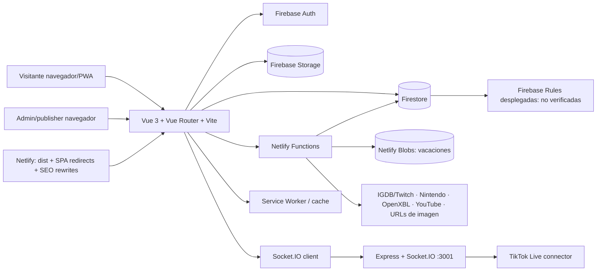
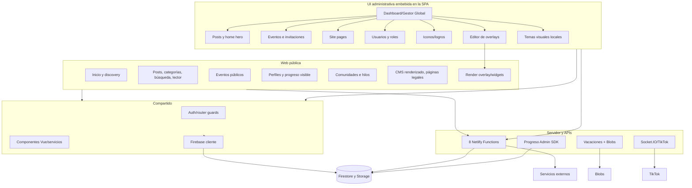
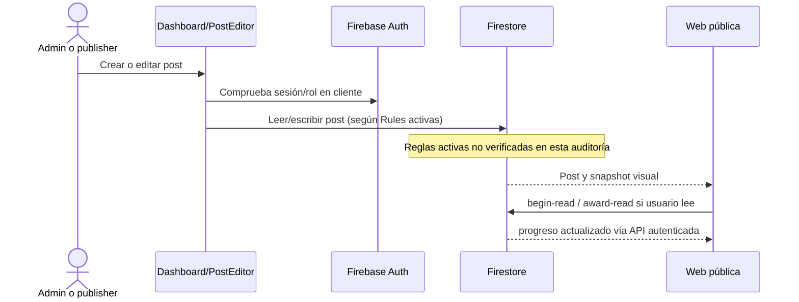
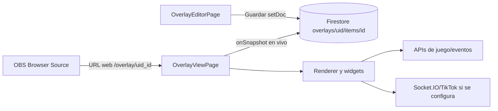

# 06. Mapa de arquitectura actual

## Sistema y datos

## Dominios y dependencias

## Flujo editorial

Los diagramas representan conexiones visibles en el repositorio; la topología de producción debe contrastarse con paneles cloud y reglas desplegadas.

## Flujo OBS actual

El listener permite que Guardar actualice el Browser Source sin recargar. No se encontró servidor local en el repo; el origin actual es web.
