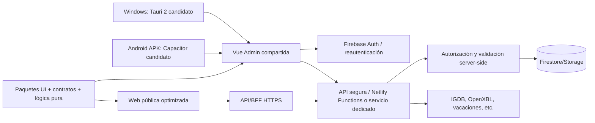

# 07. Arquitectura propuesta

## Separación de responsabilidades

1. **Web pública:** rutas y bundles de lectura/participación pública. Excluir código de edición del bundle inicial mediante aplicaciones/entradas separadas y módulos compartidos por contrato.
2. **App administrativa privada:** mismo Vue 3, formularios y servicios compartidos; distribución local Windows y APK Android. No publicar su UI como página pública. Las llamadas remotas usan HTTPS y Firebase Auth/OIDC con autorización backend.
3. **Backend:** conservar Firestore/Storage y Netlify Functions donde encaje; centralizar autorización por operación, validación, auditoría y límites de recursos. Ningún secreto servidor en APK/desktop/web bundle. Para operaciones críticas, backend verifica ID token, estado bloqueado, rol vigente y propiedad.
4. **Paquetes compartidos:** modelos/validadores puros, tipos, renderers, design tokens y cliente API con errores tipados; separación de adaptadores de plataforma para almacenamiento/portapapeles/archivos.

## Sincronización Firebase y estado local

Firestore debe ser la fuente compartida de overlays: MagicPad/Windows guarda con Firebase Auth y OBS escucha cambios en vivo. Para formularios/listas administrativas bastan lecturas puntuales y guardar; reservar `onSnapshot` para overlay OBS, chats/inbox y feeds que requieren actualidad. Añadir versión de esquema, `updatedAt/updatedBy` y control de conflicto transaccional/aditivo; preservar los documentos legacy.

Estado local que podría no llegar al otro dispositivo: `galaxia-visual-themes-v1` y su historial; `galaxia-visual-theme-integrations`; `galaxia-social-library` y `galaxia-social-template[-<style>]` (plantillas con espejo parcial en `users/{uid}/socialTemplates`); marcadores y continuación de lectura; favoritos/hints de comunidades, búsquedas recientes, última ruta/welcome (parte sessionStorage); `ruzafa-creative-label`, orden de acciones y recordatorio de impresora. Configuración creativa candidata a migrar/exportar; hints/historial local pueden permanecer por dispositivo. No sincronizar secretos ni tokens.

## OBS: Browser Source, servicio local y MagicPad

- **Conservar modo web actual** como compatibilidad: el editor escribe `overlays/{uid}/items/{id}` y el viewer `/overlay/:id` usa `onSnapshot`. Así Guardar desde tablet actualiza OBS/Windows sin la ventana del editor abierta.
- Para URL local `http://127.0.0.1:<puerto>/overlay/<id>`, diseñar un servicio/sidecar local separado del shell. Debe servir renderer/assets y leer solo overlays autorizados, ser read-only desde viewer, mantener proceso cuando se cierra UI si se habilita y ofrecer start/stop/auto-start/estado. Guardar credenciales en almacén seguro del SO; usar token de lectura revocable y acotado, puerto local aleatorio y allowlist Origin para OBS.
- Default bind `127.0.0.1`, no LAN. `localhost` en OBS apunta al PC que corre OBS, no a MagicPad; la tablet edita y sincroniza por HTTPS/Firebase. Pairing LAN opcional requeriría autenticación explícita, cifrado y exposición temporal.
- Servicio Windows puede implementarse como daemon/servicio de usuario o proceso separado con bandeja; validar ciclo de vida tras cerrar ventana y reiniciar. Android limita ejecución estable en fondo; MagicPad no debe ser hosting requerido para OBS. Si se necesita modo remoto, mantener URL HTTPS existente.
- Preservar ID `uid_overlayId`, documento, `widgets[]`, dimensiones, formato, posiciones/escala, transparencias, modo interactive, query `?v=` y enlaces guardados. No renombrar/borrar hasta probar Browser Sources legacy.
- Distinguir chat de widget/Firestore o direct chat del bridge TikTok Socket.IO y de Twitch (tmi.js si aún se usa). F26 tiene CORS `*`, `joinTikTok` sin auth/límites visibles y conexión global reemplazable: antes de exponer como servicio local, definir usuario, canal, lifecycle, autenticación y rate limits. No incluir credenciales de proveedor en binarios.
- Si Firebase está offline, mostrar último overlay cacheado con degradación explícita; TikTok/presencia no se garantizan offline.

## Tecnologías de empaquetado

- **Capacitor:** ajuste natural para la SPA Vue y distribución Android; Windows desktop no es su destino principal y la experiencia suele depender de un wrapper separado.
- **Tauri 2:** adecuado para desktop Windows con WebView2 y también soporta Android; requiere integración/QA adicional de plugins y empaquetado Android. Puede permitir un solo shell multiplataforma, sujeto a validar capacidades usadas (cámara, archivos, export PNG, auth OAuth, WebSocket).
- **PWA instalada:** útil como fase puente sin nueva app store, pero no satisface distribución APK local según el requisito.
- **Electron:** maduro en Windows, mayor coste de runtime/tamaño; no resuelve Android con la misma app.

**Recomendación provisional:** probar un prototipo vertical Tauri 2 con Vue en Windows y Android antes de decidir. Minimiza shells independientes si los plugins que usan editor de imágenes, cámara/archivos, login OAuth, exportaciones y realtime son compatibles. Mantener Capacitor como alternativa si Android domina y desktop puede ser PWA/Tauri aparte. No seleccionar decisión final hasta validar dispositivo Honor MagicPad 4, autenticación, almacenamiento seguro y build local.

Tauri 2 queda como primera candidata única a validar para maximizar Vue/código compartido; Capacitor es fallback Android si soporte de plugins/login en MagicPad resulta mejor. El servicio OBS local será un proceso separado del shell UI.

## Controles estructurales

- App de administración en origin/esquema independiente y allowlist de origins; no guardar refresh token en `localStorage` si se dispone de storage seguro del sistema.
- Tokens de sesión revocables; expiración, refresh y cierre de sesión; pérdida del dispositivo con revocación de refresh tokens y sesión backend.
- Policies Firestore/Storage minimizadas y probadas en emulador; todas las escrituras admin pasan por autorización efectiva.
- Auditoría de cambios de rol, borrados, publicación, reglas/configuración y contenido; versionado/rollback.
- RBAC por acción (admin, publisher, moderador/propietario si aplica), no por visibilidad de botón.
- Estrategia offline explícita: lectura caché puede ser aceptable, cambios admin offline en cola solo si hay idempotencia/conflicto y confirmación.
